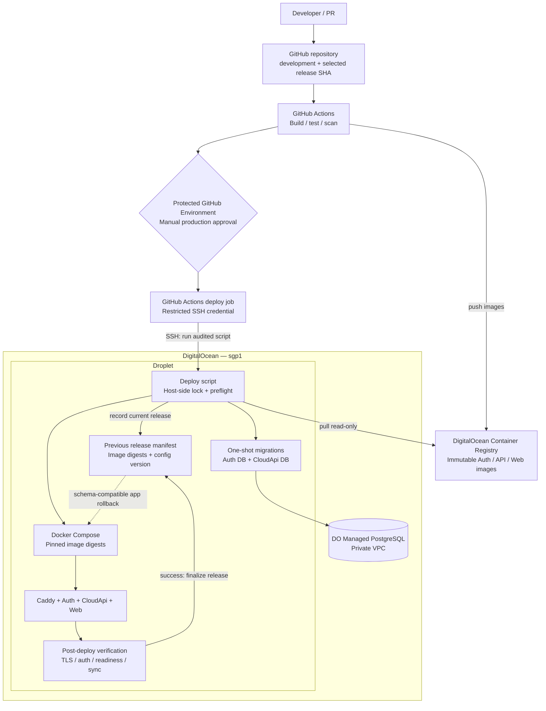

# IndyPOS cloud CI/CD and deployment architecture

**Status:** Recommended workflow, **not yet implemented end-to-end**.  
**Operations:** [Cloud deployment runbook](../operations/cloud-deployment.md).  
**Infrastructure:** [Cloud infrastructure diagram](cloud-infrastructure.md).

## Release contract

1. PR CI builds and tests without production secrets.
2. A selected commit or release builds and pushes separate immutable images. Record their digests.
3. Production deployment requires a protected GitHub Environment with manual approval; merging `development` alone does **not** deploy.
4. The deploy job uses a restricted SSH identity to call an audited script on the Droplet. Only the Droplet connects to managed PostgreSQL through its private VPC.
5. The host deploy script serializes releases, checks configuration and backup status, records the previous release, pulls with read-only registry credentials, and runs explicit one-shot migrations.
6. Start/update Compose services only after migrations succeed. Verify HTTPS, issuer/redirects, login, API liveness/readiness, store credentials and sync.
7. Keep previous image digests/config for rollback. **Rollback applications only when compatible with forward-only database migrations**; restoring the DB is an incident-recovery procedure, not normal deployment rollback.
8. Record deployment SHA, operator, migration versions, smoke-test result and alerts. Keep bounded logs and registry retention.

## Security and availability notes

- Store signing keys and secrets must persist through redeploys and be recoverable; never bake them into Docker images or release manifests.
- Keep DNS-edit Cloudflare credentials confined to Caddy; use per-service DB roles and separate credentials.
- Single-Droplet deployment may briefly interrupt cloud-only functions; offline-first tills continue operating. Schedule risky releases in low-usage periods.
- If a migration or smoke test fails, stop the rollout and inspect state; do not claim deployment succeeded or blindly downgrade the database.
- The actual GitHub Actions workflow, Compose topology, SSH deployment script and environment configuration must be implemented and validated before following this diagram operationally.
