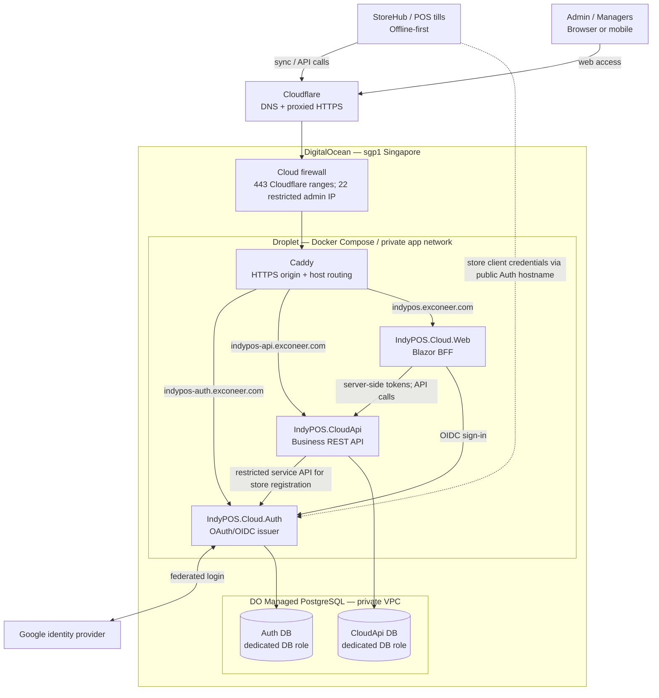

# IndyPOS cloud infrastructure architecture

**Status:** Target architecture (not a statement of what is currently deployed).  
**Source of truth:** [Approved cloud platform and identity design](../superpowers/specs/2026-10-21-cloud-platform-and-identity-design.md).  
**Operations:** [Cloud deployment runbook](../operations/cloud-deployment.md).

## Hostname and responsibility map

| Hostname | Service | Status |
|---|---|---|
| `indypos.exconeer.com` | Cloud.Web, Blazor BFF | Planned target |
| `indypos-auth.exconeer.com` | Cloud.Auth, issuer for people and stores | Planned target |
| `indypos-api.exconeer.com` | CloudApi, business API and resource server | Planned target |
| `indypos-mcp.exconeer.com` | Cloud.Mcp | Future phase; not in initial stack |

## Trust boundaries and operational rules

- Cloudflare proxies public hostnames; Cloudflare SSL/TLS mode is **Full (strict)**. Caddy obtains a publicly trusted origin certificate with DNS-01. The DNS-write token is available to Caddy only.
- Only Caddy publishes TCP 443 on the Droplet. No public application container or PostgreSQL port. SSH access is restricted; maintain Cloudflare IP allowlist.
- Cloud.Auth and CloudApi have **separate databases and roles** on the same DO Managed PostgreSQL cluster; Cloud.Web never connects to either database directly.
- Auth is the **sole token issuer**. CloudApi validates tokens and enforces manager-to-store authorization **per request**. Inter-service calls require explicit authentication; container network placement alone is not authorization.
- StoreHub continues local sales when the cloud or Auth is unreachable. Cloud sync retries safely and must be idempotent.
- Planned Cloud.Mcp, Tower mobile client and Workforce SaaS are intentionally not shown as deployed services. Workforce SaaS should have an independent stack and identity boundary.
- Deployment readiness, migrations, backup/restore drills, and incident response are covered by the linked runbook.
