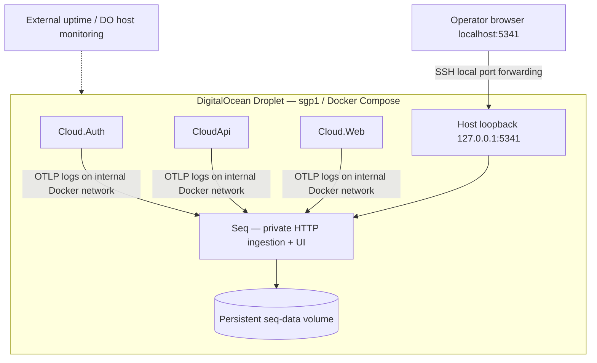

# IndyPOS Cloud — Self-hosted Seq Observability Plan

**Status:** Direction accepted (Pond, 2026-10-23): self-hosted Seq, **OTLP** transport. Details still open in §11.  
**Date:** 2026-10-23  
**Scope:** IndyPOS.Cloud.Auth, IndyPOS.CloudApi, IndyPOS.Cloud.Web, Caddy (optional), deployment operations  
**Related:** `docs/operations/cloud-deployment.md`, `docs/diagrams/cloud-infrastructure.md`, `docs/diagrams/cloud-cicd-deployment.md`

## 1. Decision proposal

Use **self-hosted Seq** as the initial **centralized structured-log backend** for IndyPOS Cloud, running as a separate Docker Compose service on the Singapore DigitalOcean Droplet. Keep instrumentation based on **Microsoft.Extensions.Logging + OpenTelemetry** (OTLP) to avoid coupling application code to Seq.

**Why OTLP, not Serilog.Sinks.Seq** (Pond, 2026-10-23): `IndyPOS.ServiceDefaults` already configures OpenTelemetry logs, metrics and traces and exports OTLP when `OTEL_EXPORTER_OTLP_ENDPOINT` is set — that is how the Aspire dashboard gets its data in development. Pointing it at Seq in production keeps **one pipeline from dev to prod**, sends **traces as well as logs** (a sign-in crosses Web → Auth → Google → CloudApi), is mostly configuration rather than code in three apps, and stays vendor-neutral. `ILogger<T>` call sites do not change. The cloud apps do not take a Serilog dependency; the WinForms till keeps its local Serilog files. Use **private access via SSH tunnel** for the Seq web UI; do not expose it through Caddy or Cloudflare in the pilot.

Seq is for **logs and log-based investigations**; it does not replace uptime probes, infrastructure metrics, distributed tracing storage, database backups, or incident alerting. Validate Seq's current licensing and OTLP support against the pinned image version before rollout.

### Goals

- Search errors and events across Auth, API and Web from one browser UI.
- Correlate requests using trace/span identifiers, service name, deployment version and store context.
- Diagnose authentication failures, store sync failures and deployment regressions without SSH-ing into each container.
- Control retention, storage, access and sensitive-data exposure.
- Maintain an easy path to another OTLP-compatible backend later.

### Non-goals (initial pilot)

- High-availability log cluster or zero-loss log delivery during host outages.
- Public Seq dashboard or customer access to internal logs.
- Replacing DigitalOcean host metrics or external uptime checks.
- Storing full HTTP payloads, customer records, access/refresh tokens, secrets or card/payment details.

## 2. Architecture



**Initial preference:** direct OTLP log export from .NET apps to Seq over an internal Docker network. **Optional later:** insert OpenTelemetry Collector when filtering, buffering, routing to multiple destinations or richer telemetry pipelines become necessary. Verify endpoint paths/protocol with the **specific pinned Seq version**; do not assume the OTLP HTTP endpoint is the same as the UI root.

## 3. Deployment and network design

- Add a `seq` service to the production Compose stack **only after** resource/load testing; do not assume the existing 2 vCPU / 4 GiB Droplet has sufficient headroom.
- Pin the Seq image to a tested version/digest; persist `/data` on a named volume or dedicated block-storage mount. Define restart policy and resource limits/reservations appropriate to measured usage.
- Keep Seq on an internal application/observability Docker network accessible only to log-producing services. Do not publish its ingestion endpoint publicly.
- **The `observability` network is an extra network on Auth, API and Web, never their only one.** An `internal: true` network has no outbound route, and these services need it: Auth reaches Google, CloudApi fetches Auth's discovery document and keys through Cloudflare, every service reaches the managed PostgreSQL.
- Bind its web UI to **host loopback only**, e.g. `127.0.0.1:5341:80` (confirm image's UI port). No Cloudflare DNS record, no public Caddy route, no firewall opening for 5341.
- Use an initial admin password from protected server-side secret configuration. Never commit it or print it in CI logs. Configure accounts/roles per licensing and team access requirements.
- Keep Docker stdout/stderr logging with rotation as an emergency fallback. If Seq is unavailable, application requests must still work; log exporter must use bounded queues/timeouts and avoid blocking checkout/sync paths.
- Seq data consumes local disk and I/O; alert on volume usage and maintain disk free space for PostgreSQL clients, container runtime and deployment images.

### Illustrative Compose fragment (not drop-in production config)

```yaml
services:
  seq:
    image: datalust/seq:${SEQ_VERSION:?Pin a tested version}
    restart: unless-stopped
    environment:
      ACCEPT_EULA: "Y"
      SEQ_FIRSTRUN_ADMINPASSWORD: ${SEQ_ADMIN_PASSWORD:?Set secure password}
    ports:
      - "127.0.0.1:5341:80"
    volumes:
      - seq-data:/data
    networks:
      - observability

volumes:
  seq-data:

networks:
  observability:
    internal: true
```

> Integrate the network with the real Auth/API/Web service definitions and validate that Docker port publishing plus `internal: true` behaves as intended on the target host. Do not paste this fragment over the existing production Compose file. Prefer an explicit, tested host binding and firewall verification.

## 4. Operator access to Seq UI

1. Confirm Seq is healthy on the Droplet and port `5341` is **not** reachable from the public Internet.
2. On an authorized workstation, establish SSH forwarding (adjust user, SSH key and host):

   ```bash
   ssh -N -L 5341:127.0.0.1:5341 deploy@YOUR_DROPLET_IP
   ```

3. Open **http://localhost:5341** and sign in using Seq credentials.
4. Close the SSH session to close the tunnel. If the local port is occupied, use another local port (e.g. `15341:127.0.0.1:5341`) and browse to `http://localhost:15341`.

For multiple operators, evaluate **Tailscale** or **Cloudflare Access with correctly enforced identity and origin restrictions**, rather than exposing Seq unauthenticated. Restrict SSH keys and operator permissions; access to logs can reveal operational and customer metadata.

## 5. .NET instrumentation contract

Use `ILogger<T>` for application logs and OpenTelemetry log exporting, configured by service. Preserve console logs as fallback. Follow the existing telemetry setup rather than adding duplicate exporters.

**One Seq API key per service.** Each of Auth, API and Web sends its own key (`OTEL_EXPORTER_OTLP_HEADERS=X-Seq-ApiKey=<key>`), even on the internal network: Seq then shows which service sent an event, a key can carry its own minimum level (raise one noisy service without a redeploy), and a leaked key can be revoked alone. Keys live in the server-side secret configuration with the other per-service secrets — never in the repo, Compose file or CI logs.

Recommended resource/context fields:

| Field | Example | Notes |
|---|---|---|
| `service.name` | `indypos.cloudapi` | Unique per service |
| `service.version` | git SHA or release tag | Immutable deployed version |
| `deployment.environment.name` | `production` | Consistent across services |
| `trace_id`, `span_id` | from current Activity | Enable cross-service investigation |
| `store.id` | stable opaque identifier | Only when authorized and relevant |
| `operation.name` | `store.sync.upload` | Low-cardinality operation label |
| `error.type` | exception class | Do not expose secret-bearing messages |
| `http.route`, `http.response.status_code` | `/stores/{id}`, `500` | Prefer route templates over raw URLs |

**Never log:** Authorization headers, bearer tokens, client secrets, passwords, Google OAuth codes, refresh tokens, signing keys, raw customer PII, full request/response bodies, card data or bank details. **IndyPOS specifics:** never log a sync event's `PayloadJson` or any raw outbox/inbox event body — ลงบัญชี (PayLater) events carry **debtor names**, which are personal data; never log an invoice's line items or a customer name; log event ids, types, store ids and reason codes instead. CloudApi logs Cloud.Auth's error *bodies* only at Warning and never returns them to callers (already the case after S1-1). Avoid high-cardinality labels such as email addresses or raw URLs with query parameters. Apply redaction at the application boundary, not only in Seq.

### Event examples

```csharp
logger.LogWarning(
    "Store sync retry scheduled for {StoreId}; attempt {Attempt}; reason {ReasonCode}",
    storeId, attempt, reasonCode);

logger.LogError(exception,
    "Cloud API request failed for {OperationName}; status {StatusCode}",
    operationName, statusCode);
```

Use stable event names and structured properties. Treat auth failures as security-relevant events, but avoid logging the submitted credentials or full identity claims.

### Alerts and where they go

Seq alerts need a destination. **Open decision for Pond:** email to the operator, or a webhook into LINE (where store issues already get discussed). Initial alerts, each a Seq alert on a saved search:

- error rate per `service.name` above a threshold for 5 minutes;
- Cloud.Auth refusing a store's token repeatedly (`invalid_client` for one `store_id`);
- CloudApi's `/sync/events` refusals (the sync rejection log) for any store;
- `AuthUnavailableException` (CloudApi cannot reach Auth);
- readiness failures (database unreachable).

External uptime checks and DigitalOcean host alerts stay independent of Seq (§8): Seq being down must still page someone.

## 6. Suggested investigations and saved queries

- **Deployment regression:** errors by `service.name` and `service.version` for the first 30 minutes after release.
- **Store sync failures:** filter by `store.id` + `operation.name` and correlate `trace_id`; compare retries, terminal failures and duplicate detection.
- **Auth issues:** group login/token issuance failures by safe reason codes, grant type and service; never include token contents.
- **Database connectivity:** readiness failures, timeouts and migration events with deployment version.
- **Operational overview:** warning/error counts per service, recent exceptions and top failing operations.

Seq query syntax varies with event shape and version; create and verify saved searches against real sample logs rather than copying untested query expressions.

## 7. Retention, backups and recovery

- Start with **7 days retention**, consider 14 days if disk measurements support it. Enforce a storage/retention policy and alert at **70% / 85%** of the allocated log volume.
- Estimate daily ingestion from a pilot load test (including bursts) before choosing volume size. Do not rely on the Droplet root disk indefinitely.
- **Logs are operational data, not the system of record.** Primary priority is database backup/restore. Decide whether Seq data warrants separate backups based on audit/incident requirements; a persistent volume alone is **not** a backup.
- Document restore/rebuild: provision Seq with pinned image, restore data only if needed/compatible, recreate credentials and saved queries/configuration, verify ingestion. Test once before production use.
- During Seq outage, applications continue processing; some log events may be dropped unless a tested buffering mechanism exists. Explicitly document this limitation.

## 8. Monitoring and security

- External HTTPS uptime monitoring for API/Auth/Web, independent of Seq.
- DO host alerts: CPU, RAM, disk usage, restart loops; container logs and Seq health.
- Verify certificate renewals for public Caddy endpoints separately.
- Protect Seq admin access, rotate credentials, apply image updates, and review license terms (including number of UI users).
- Treat log access as privileged: least-privilege access, audit where supported, and a clear data-retention/privacy policy.
- Avoid unbounded debug-level logs in production. Default to Information, tune noisy categories, and temporarily enable Debug only with explicit expiration.

## 9. Rollout phases

### Phase 0 — Design verification

- [ ] Confirm current Seq image/version, licensing, Docker ports and OTLP protocol/path from vendor docs.
- [ ] Confirm existing .NET OpenTelemetry configuration and required packages.
- [ ] Establish expected log volume and available Droplet headroom; choose whether 4 GiB is enough or upgrade to 8 GiB.
- [ ] Agree on retention, access model, event schema and secret-redaction requirements.

### Phase 1 — Non-production proof of concept

- [ ] **Prove it on the Aspire dev stack first.** Add Seq to `IndyPOS.AppHost` (Aspire's Seq hosting integration, pinned image) and point the cloud services' OTLP at it alongside the dashboard, so service names, trace correlation, API keys and the "never log" rules are checked on a laptop before anything touches the Droplet.
- [ ] Start pinned Seq container with persistent volume and loopback-only UI.
- [ ] Export sample logs from Auth/API/Web via OTLP and confirm service names, versions and trace correlation.
- [ ] Verify SSH tunnel access and verify public port scan **cannot** reach Seq.
- [ ] Induce Seq outage and confirm API/Auth/Web remain functional.
- [ ] Run ingestion/load test; measure CPU/RAM/disk and test log retention cleanup.

### Phase 2 — Production pilot

- [ ] Add Compose config, scoped secrets, backup/rebuild instructions and monitoring alerts to deployment PR.
- [ ] Deploy behind manual production approval, with rollback to previous Compose/image manifest.
- [ ] Verify post-deployment logging and saved investigations; validate no sensitive fields appear.
- [ ] Review usage after 1–2 weeks; adjust retention, storage and resources.

### Phase 3 — Later enhancements (only if justified)

- [ ] Add OTel Collector for advanced routing/filtering/buffering.
- [ ] Consider dedicated Seq Droplet or managed log backend if contention, availability or security isolation requires it.
- [ ] Evaluate private multi-operator access and richer alerting integrations.

## 10. Acceptance criteria

1. Auth/API/Web emit searchable structured logs with service name, release SHA and trace correlation.
2. Seq UI is reachable through an authorized SSH tunnel, **not** from a public endpoint.
3. No credentials, tokens or sensitive payment/customer payloads appear in sampled logs.
4. Loss of Seq does **not** interrupt POS cloud requests or offline store sales.
5. Retention and disk alerts are configured and tested.
6. Deploy/rollback/rebuild instructions are reproducible; Seq data persistence verified after container recreation.
7. Team confirms current license terms, access controls and observed resource usage.

## 11. Open decisions for team

| Decision | Proposed default |
|---|---|
| Hosting | Same DO Droplet for pilot, revisit after load test |
| Access | SSH tunnel, one authorized operator initially |
| Logging transport | **Decided: OTLP directly from .NET to Seq** (Pond, 2026-10-23); not Serilog.Sinks.Seq |
| Ingestion auth | One Seq API key per service, via `OTEL_EXPORTER_OTLP_HEADERS` |
| Alert destination | **Pond to decide:** email, or a webhook into LINE |
| Collector | Defer |
| Retention | 7 days initially |
| Disk allocation | Set after ingestion test |
| Droplet sizing | Benchmark 4 GiB; plan upgrade to 8 GiB if needed |
| Seq backup | Rebuildable unless audit requirements mandate log recovery |
| Rollout | Non-prod POC, then manually approved pilot |

---

**Implementation note:** This is a proposal, not a claim that Seq has already been installed or configured in IndyPOS. Confirm all environment variable names, protocol endpoints and Compose integration against the chosen Seq release and the repository's actual deployment assets before implementation.
